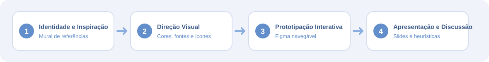

logo refeita oficial ultra hiper blaster wow

<h1 align="center">Design de Interface — TP3</h1>

<p align="center">
  <b>Do mural de inspiração ao protótipo interativo do Camp Food</b><br>
  Interação Humano-Computador · Universidade Federal do Amazonas (UFAM)
</p>

<p align="center">
  <a href="#-sobre-o-projeto">Sobre</a> ·
  <a href="#-etapas-do-trabalho">Etapas</a> ·
  <a href="#-navegação-rápida">Navegação</a> ·
  <a href="#-ferramentas">Ferramentas</a> ·
  <a href="#-equipe">Equipe</a> ·
  <a href="#-organização-do-repositório">Estrutura</a>
</p>

---

## ● Sobre o projeto

Este repositório reúne o design completo da interface do **Camp Food**, apresentado por meio de um **protótipo interativo** com foco na qualidade de uso. O protótipo representa não apenas o aspecto visual da solução, mas também os principais fluxos de interação e as respostas do sistema, demonstrando como o usuário realiza as principais tarefas no aplicativo.

O trabalho dá continuidade ao [repositório do TP2]([PREENCHER: link do repositório Design-IHC]) (imersão, ideação e sketches), mantendo coerência com as personas, os HTAs, os diagramas MoLIC e os sketches ali desenvolvidos.

| | |
|---|---|
| **Aplicativo** | Camp Food |
| **Disciplina** | Interação Humano-Computador (IHC) |
| **Professor** | Dr. Andrey Rodrigues |
| **Instituição** | Universidade Federal do Amazonas (UFAM) |
| **Entrega** | **[PREENCHER: data e horário definidos no Classroom]** |
| **Protótipo no Figma** | **[PREENCHER: link do protótipo]** |
| **Apresentação (slides)** | **[PREENCHER: link ou arquivo dos slides]** |

---

## ● Etapas do trabalho

<p align="center">
  
</p>

| Etapa | Foco |
|---|---|
| **1 · Identidade e Inspiração** | Referências visuais que orientam o estilo e o clima do aplicativo. |
| **2 · Direção Visual** | Paleta de cores, tipografia, ícones, ilustrações, nome e logotipo. |
| **3 · Prototipação Interativa** | Telas finais, tutorial (onboarding), fluxos navegáveis e microinterações no Figma. |
| **4 · Apresentação e Discussão** | Heurísticas de Nielsen, acessibilidade, comunicabilidade e slides da apresentação. |

---

## ● Navegação rápida

| # | Pasta | Conteúdo | Situação |
|---|---|---|---|
| 1 | [Mural de inspiração](design-interface/1-mural-de-inspiracao/README.md) | Imagens e fontes de referência | Pendente |
| 2 | [Paleta e tipografia](design-interface/2-paleta-tipografia/README.md) | Cores, fontes, nome e logotipo, justificativas | Pendente |
| 3 | [Ícones e ilustrações](design-interface/3-icones-ilustracoes/README.md) | Exemplos e explicações | Pendente |
| 4 | [Design final](design-interface/4-design-final/README.md) | Telas exportadas, tutorial e link do protótipo | Pendente |
| 5 | [Microinterações](design-interface/5-microinteracoes/README.md) | Vídeos ou GIFs de microanimações | Pendente |
| 6 | [Heurísticas e UX](design-interface/6-heuristicas-ux/README.md) | Usabilidade, UX, comunicabilidade e acessibilidade | Pendente |

> [!TIP]
> Atualize a coluna **Situação** (*Pendente*, *Em andamento*, *Concluído*) conforme o grupo avançar.

---

## ● Ferramentas

- **GitHub** — organização e documentação do projeto;
- **Markdown** — elaboração dos documentos;
- **Figma Design** — design final e protótipo interativo (uso obrigatório);
- **[PREENCHER]** — demais ferramentas utilizadas (ex.: Canva, Krita, Draw.io, Google Slides).

---

## ● Equipe

<table>
  <tr>
    <td align="center" width="33%"><b>Ana Vitória Farias Barroso</b></td>
    <td align="center" width="33%"><b>Jucilla Kétura Souza Sousa</b></td>
    <td align="center" width="33%"><b>Letícia Abreu de Araújo Marques</b></td>
  </tr>
  <tr>
    <td align="center" width="33%"><b>Luís Gustavo da Silva Gomes</b></td>
    <td align="center" width="33%"><b>Paolla Gabriele dos Santos Costa</b></td>
    <td align="center" width="33%"><b>Willian Gonçalves Monteiro</b></td>
  </tr>
</table>

---

## ● Declaração de uso de Inteligência Artificial

**[REVISAR: ajustar ao uso real de IA neste trabalho antes da entrega.]**

Declaramos que, durante o desenvolvimento deste trabalho, foram utilizadas ferramentas de Inteligência Artificial (IA) como recurso de apoio, com a finalidade de auxiliar na organização e no aprimoramento do conteúdo apresentado, principalmente em revisão ortográfica e gramatical e na organização de ideias.

As ferramentas de IA não substituíram o processo de pesquisa, análise, discussão e tomada de decisões do grupo. Todo o conteúdo gerado ou sugerido foi avaliado, revisado e adaptado pelos integrantes, que permanecem responsáveis pela versão final do trabalho.

---

## ● Organização do repositório

```text
TP3-IHC/
├── README.md
├── assets/                          # banners e diagramas do repositório (banners/, diagramas/)
└── design-interface/
    ├── 1-mural-de-inspiracao/       # imagens e fontes de referência
    ├── 2-paleta-tipografia/         # cores, fontes e justificativas
    ├── 3-icones-ilustracoes/        # exemplos e explicações
    ├── 4-design-final/              # telas exportadas e link para o protótipo
    ├── 5-microinteracoes/           # vídeos ou GIFs de microanimações
    └── 6-heuristicas-ux/            # usabilidade, UX, comunicabilidade e acessibilidade
```

Cada pasta contém um `README.md` (a página da seção, já estruturada para preenchimento) e uma subpasta para os arquivos de mídia.

---

## ● Regras de entrega

<details>
<summary><b>● Ver regras do enunciado</b></summary>

<br>

- O link do repositório deve ser enviado pelo **Google Classroom**, na aba correspondente, até a data estipulada no sistema;
- **Atrasos** acarretam desconto de pontos;
- **Ausência não justificada** na apresentação acarreta desconto de pontos;
- **Não são permitidos commits** após a data de entrega; qualquer commit extra implica desconto de pontos;
- É **obrigatório** preparar uma apresentação em slides;
- O design final deve ser desenvolvido **obrigatoriamente no Figma Design**, com interações e transições configuradas (telas estáticas não bastam);
- O protótipo deve ser coerente com os artefatos anteriores: HTAs, diagramas MoLIC e sketches.

</details>

## ● Checklist antes de enviar o link

- [ ] Todos os `[PREENCHER]` e `[REVISAR]` foram resolvidos (veja o comando abaixo);
- [ ] O link do protótipo no Figma abre **sem pedir login** (compartilhamento por link, modo *view*);
- [ ] O tutorial (onboarding) está em um fluxo separado no Figma e linkado em `4-design-final`;
- [ ] Imagens, GIFs e vídeos abrem corretamente no GitHub (caminhos relativos conferidos);
- [ ] Tabela de **Navegação rápida** atualizada;
- [ ] Slides da apresentação prontos e linkados;
- [ ] Último commit feito **antes** do envio do link no Classroom.

<details>
<summary><b>● Como encontrar pendências no repositório</b></summary>

<br>

Na raiz do repositório, rode no terminal:

```bash
grep -rn "PREENCHER\|REVISAR" --include="*.md" .
```

Se não retornar nenhuma linha, não há campos pendentes.

</details>

---

<p align="center">
  Este repositório é atualizado ao longo do desenvolvimento do trabalho, registrando as etapas,<br>
  os resultados e as decisões de design tomadas pela equipe.<br><br>
  <sub>UFAM · 2026</sub>
</p>
