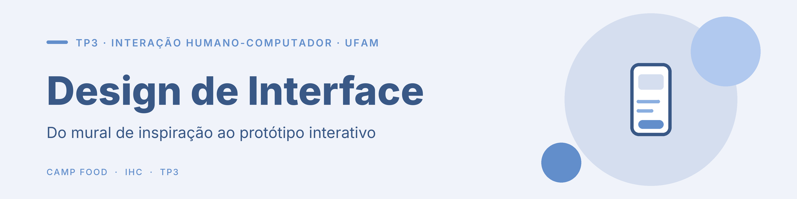

<p align="center">
  
</p>

<h1 align="center">Design de Interface — TP3</h1>

<p align="center">
  <b>Do mural de inspiração ao protótipo interativo do Camp Food</b><br>
  Interação Humano-Computador · Universidade Federal do Amazonas (UFAM)
</p>

<p align="center">
  <a href="#-sobre-o-projeto">Sobre</a> ·
  <a href="#-etapas-do-trabalho">Etapas</a> ·
  <a href="#-navegação-rápida">Navegação</a> ·
  <a href="#-ferramentas">Ferramentas</a> ·
  <a href="#-equipe">Equipe</a> ·
  <a href="#-organização-do-repositório">Estrutura</a>
</p>

---

## ● Sobre o projeto

Este repositório reúne o design completo da interface do **Camp Food**, apresentado por meio de um **protótipo interativo** com foco na qualidade de uso. O protótipo representa não apenas o aspecto visual da solução, mas também os principais fluxos de interação e as respostas do sistema, demonstrando como o usuário realiza as principais tarefas no aplicativo.

O trabalho dá continuidade ao [repositório do TP2](https://github.com/luisgomes-beep/Design-IHC) (imersão, ideação e sketches), mantendo coerência com as personas, os HTAs, os diagramas MoLIC e os sketches ali desenvolvidos.

| | |
|---|---|
| **Aplicativo** | Camp Food |
| **Disciplina** | Interação Humano-Computador (IHC) |
| **Professor** | Dr. Andrey Rodrigues |
| **Instituição** | Universidade Federal do Amazonas (UFAM) |
| **Entrega** | **03/12/2026** |
| **Protótipo no Figma** | **link link link** |
| **Apresentação (slides)** | **se não termianr antes não bota** |

---

## ● Etapas do trabalho

| Etapa | Foco |
|---|---|
| **1 · Identidade e Inspiração** | Referências visuais que orientam o estilo e o clima do aplicativo. |
| **2 · Direção Visual** | Paleta de cores, tipografia, ícones, ilustrações, nome e logotipo. |
| **3 · Prototipação Interativa** | Telas finais, tutorial (onboarding), fluxos navegáveis e microinterações no Figma. |
| **4 · Apresentação e Discussão** | Heurísticas de Nielsen, acessibilidade, comunicabilidade e slides da apresentação. |

---

## ● Navegação rápida

| # | Arquivo | Conteúdo | 
|---|---|---|
| 1 | [Mural de inspiração](design-interface/1-mural-de-inspiracao.md) | Imagens e fontes de referência | 
| 2 | [Paleta e tipografia](design-interface/2-paleta-tipografia.md) | Cores, fontes, nome e logotipo, justificativas | 
| 3 | [Ícones e ilustrações](design-interface/3-icones-ilustracoes.md) | Exemplos e explicações | 
| 4 | [Design final](design-interface/4-design-final.md) | Telas exportadas, tutorial e link do protótipo | 
| 5 | [Microinterações](design-interface/5-microinteracoes.md) | Vídeos ou GIFs de microanimações | 
| 6 | [Heurísticas e UX](design-interface/6-heuristicas-ux.md) | Usabilidade, UX, comunicabilidade e acessibilidade | 

---

## ● Ferramentas

- **GitHub** — organização e documentação do projeto;
- **Markdown** — elaboração dos documentos;
- **Figma Design** — design final e protótipo interativo (uso obrigatório);
- ** outras

---

## ● Equipe

<table>
  <tr>
    <td align="center" width="33%"><b>Ana Vitória Farias Barroso</b></td>
    <td align="center" width="33%"><b>Jucilla Kétura Souza Sousa</b></td>
    <td align="center" width="33%"><b>Letícia Abreu de Araújo Marques</b></td>
  </tr>
  <tr>
    <td align="center" width="33%"><b>Luís Gustavo da Silva Gomes</b></td>
    <td align="center" width="33%"><b>Paolla Gabriele dos Santos Costa</b></td>
    <td align="center" width="33%"><b>Willian Gonçalves Monteiro</b></td>
  </tr>
</table>

---

## ● Declaração de uso de Inteligência Artificial

IA? queh isso, num sei, que chique, coisa de playboy, tsk tsk, vish, sei não, nunca vi

## ● Organização do repositório

```text
TP3-IHC/
├── README.md
├── assets/                          # todas as imagens do repositório
└── design-interface/
    ├── 1-mural-de-inspiracao.md     # imagens e fontes de referência
    ├── 2-paleta-tipografia.md       # cores, fontes e justificativas
    ├── 3-icones-ilustracoes.md      # exemplos e explicações
    ├── 4-design-final.md            # telas exportadas e link para o protótipo
    ├── 5-microinteracoes.md         # vídeos ou GIFs de microanimações
    └── 6-heuristicas-ux.md          # telas e explicação dos critérios (usabilidade, UX, comunicabilidade e acessibilidade)
```

<p align="center">
  <sub>UFAM · 2026</sub>
</p>
