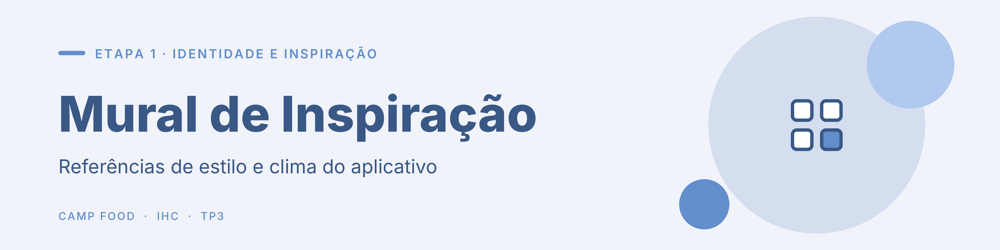

<p align="center"><b>Etapa 1 · Identidade e Inspiração</b> &nbsp;›&nbsp; Mural de Inspiração</p>

<p align="center"></p>

---

# 1. Mural de Inspiração

> [!NOTE]
> **O que o enunciado pede:** um mural de inspiração com referências visuais que orientem o **estilo e o clima** do aplicativo; imagens, capturas de tela e outros elementos que representem a **estética desejada**; referências que tragam o **conceito e as experiências** que a equipe quer transmitir. Fonte recomendada: [Material Design 3](https://m3.material.io/).

- [ ] Mural montado e exportado nesta pasta
- [ ] Referências com fonte (link ou crédito) identificada
- [ ] Conceito e experiência pretendida explicados
- [ ] Ligação entre o mural e as decisões de paleta, tipografia e ícones

## 1.1 Conceito do aplicativo

**[PREENCHER]** Em 3 a 5 linhas: qual o clima do Camp Food (ex.: acolhedor, ágil, universitário) e qual experiência a equipe quer que o usuário tenha.

## 1.2 Mural

**[PREENCHER]** Inserir a imagem do mural (Figma, Canva, Miro etc.) exportada em alta resolução.

<!-- Copie e ajuste:
<p align="center"></p>
-->

<p align="center"><sub><b>Figura 1.</b> **[PREENCHER]** legenda do mural.</sub></p>

## 1.3 Referências utilizadas

| # | Referência | Fonte / link | O que inspira |
|---|---|---|---|
| 1 | **[PREENCHER]** | **[PREENCHER]** | **[PREENCHER]** (ex.: cores quentes, cards grandes, ilustrações) |
| 2 | | | |
| 3 | | | |
| 4 | | | |
| 5 | | | |

> Adicione quantas linhas forem necessárias. Para imagens individuais, salve nesta pasta com nomes descritivos (ex.: `ref-01-ifood-cards.png`).

## 1.4 Palavras-chave do estilo

**[PREENCHER]** Liste de 4 a 6 adjetivos que resumem a direção visual (ex.: *acolhedor, vibrante, simples, acessível*) e relacione cada um a uma ou mais referências do mural.

| Palavra-chave | Referências | Como aparece na interface |
|---|---|---|
| **[PREENCHER]** | **[PREENCHER]** | **[PREENCHER]** |

## 1.5 Do mural às decisões de design

**[PREENCHER]** Explique como o mural orientou as escolhas das próximas etapas:

- **Cores:** → ver [Paleta e Tipografia](../2-paleta-tipografia/paleta-tipografia.md)
- **Tipografia:** → ver [Paleta e Tipografia](../2-paleta-tipografia/paleta-tipografia.md)
- **Ícones e ilustrações:** → ver [Ícones e Ilustrações](../3-icones-ilustracoes/icones-ilustracoes.md)
- **Layout e componentes:** → ver [Design Final](../4-design-final/design-final.md)

## 1.6 Arquivos desta seção

Coloque os arquivos diretamente nesta pasta, com nomes descritivos (ex.: `T01-acesso.png`).

```text
1-mural-de-inspiracao/
├── referencias.md
├── banner.png
└── (mural completo e referências individuais)
```


---

<p align="center"><a href="../2-paleta-tipografia/paleta-tipografia.md">Paleta e Tipografia →</a></p>
