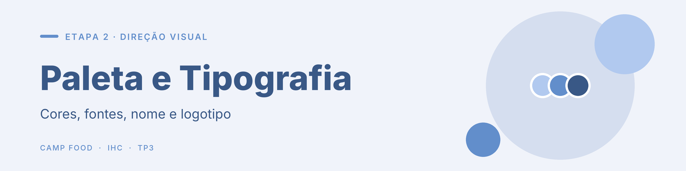

<p align="center"><b>Etapa 2 · Direção Visual</b> &nbsp;›&nbsp; Paleta e Tipografia</p>

<p align="center"></p>

---

# 2. Paleta de Cores e Tipografia

> [!NOTE]
> **O que o enunciado pede:**
> - **Paleta:** cores principal e secundária, com significado e propósito de cada uma; justificativa por **psicologia das cores** e identidade da marca; como as cores favorecem a **acessibilidade** (contraste e legibilidade), testadas no [WebAIM Contrast Checker](https://webaim.org/resources/contrastchecker/).
> - **Tipografia:** fonte **primária (títulos)** e **secundária (corpo)**, justificadas por **legibilidade** e **identidade visual** ([Google Fonts](https://fonts.google.com/), [Material Typography](https://m3.material.io/styles/typography/overview)).
> - **Nome e logotipo:** apresentar nome e logotipo, o conceito visual e semântico da identidade e como **cor, forma e tipografia** comunicam a proposta do produto.

- [ ] Paleta principal e secundária com HEX/RGB e função de cada cor
- [ ] Justificativa por psicologia das cores
- [ ] Tabela de contraste preenchida com razões do WebAIM (mínimo AA)
- [ ] Fonte primária e secundária com justificativa e escala tipográfica
- [ ] Nome e logotipo com explicação do conceito

---

## 2.1 Paleta de cores

**[PREENCHER]** Inserir a imagem da paleta (exportada do Figma) nesta pasta.

<!-- <p align="center"></p> -->

### Cores principais e secundárias

A cor de identidade principal é o azul `#628ECB`; a escala de azuis ao redor dá apoio e hierarquia.

| Papel | Nome | HEX | RGB | Significado e propósito |
|---|---|---|---|---|
| **Principal (identidade)** | **[PREENCHER]** | `#628ECB` | R98–G142–B203 | **[PREENCHER]** (onde é usada: botões primários, cabeçalho, elementos de destaque) |
| Secundária (escura) | **[PREENCHER]** | `#395886` | R57–G88–B134 | **[PREENCHER]** (ex.: títulos, texto sobre fundos claros, estados pressionados) |
| Apoio (média) | **[PREENCHER]** | `#8AAEE0` | R138–G174–B224 | **[PREENCHER]** |
| Apoio (clara) | **[PREENCHER]** | `#B1C9EF` | R177–G201–B239 | **[PREENCHER]** |
| Fundo (suave) | **[PREENCHER]** | `#D5DEEF` | R213–G222–B239 | **[PREENCHER]** (ex.: cartões, campos, divisórias) |
| Fundo (base) | **[PREENCHER]** | `#F0F3FA` | R240–G243–B250 | **[PREENCHER]** (ex.: fundo das telas) |
| Sucesso | **[PREENCHER]** | `#------` | R–G–B | Confirmações (ex.: pedido confirmado) |
| Alerta | **[PREENCHER]** | `#------` | R–G–B | Atenção (ex.: estoque baixo) |
| Erro | **[PREENCHER]** | `#------` | R–G–B | Falhas e campos inválidos |

> [!NOTE]
> A paleta azul não traz cores de estado. Sucesso, alerta e erro precisam ser definidos à parte (por convenção, verde, âmbar e vermelho) e sempre acompanhados de ícone e texto.

### Psicologia das cores e identidade da marca

**[PREENCHER]** Para cada cor principal/secundária, explique o que ela transmite e por que combina com o Camp Food (alimentos, comunidade universitária, confiança, apetite etc.).

### Acessibilidade: contraste e legibilidade

Teste cada par texto/fundo usado na interface em [webaim.org/resources/contrastchecker](https://webaim.org/resources/contrastchecker/). Critérios WCAG: **texto normal ≥ 4,5:1** (AA), **texto grande ≥ 3:1**, **componentes de interface e ícones ≥ 3:1**.

| Texto / elemento | Fundo | Razão de contraste | Texto normal (AA, ≥ 4,5) | Texto grande e componentes (≥ 3) | Onde é usado |
|---|---|---|---|---|---|
| `#395886` | `#F0F3FA` | 6,49 : 1 | Passa | Passa | Títulos e texto sobre o fundo das telas |
| `#395886` | `#FFFFFF` | 7,21 : 1 | Passa | Passa | Texto sobre cartões brancos |
| `#395886` | `#D5DEEF` | 5,33 : 1 | Passa | Passa | Texto sobre cartões e campos |
| `#FFFFFF` | `#395886` | 7,21 : 1 | Passa | Passa | Texto sobre elementos escuros |
| `#FFFFFF` | `#628ECB` | 3,36 : 1 | **Falha** | Passa | Rótulo de botão primário (usar texto grande e em negrito) |
| `#628ECB` | `#F0F3FA` | 3,02 : 1 | **Falha** | Passa | Ícones e bordas sobre o fundo (não usar para texto corrido) |
| `#395886` | `#628ECB` | 2,15 : 1 | **Falha** | **Falha** | Não usar este par |

> [!IMPORTANT]
> Valores calculados pela fórmula do WCAG; **confira cada par no WebAIM** e anexe os prints. Atenção: texto branco sobre `#628ECB` não atinge 4,5:1. Para rótulos de botão, use fonte grande (≥ 18,66 px em negrito ou ≥ 24 px), escureça o botão (ex.: `#395886`) ou use texto escuro.

**[PREENCHER]** Anexar prints do WebAIM em `contraste-*.png` (opcional, mas reforça a evidência) e comentar como cor **não** é o único meio de comunicar estado (ex.: erro = cor + ícone + texto).

---

## 2.2 Tipografia

### Fontes escolhidas

| Uso | Fonte | Pesos | Link (Google Fonts) |
|---|---|---|---|
| **Primária** (títulos) | **[PREENCHER]** | **[PREENCHER]** | **[PREENCHER]** |
| **Secundária** (corpo de texto) | **[PREENCHER]** | **[PREENCHER]** | **[PREENCHER]** |

**[PREENCHER]** Inserir imagem do specimen (alfabeto, números e exemplo de uso).

<!-- <p align="center"></p> -->

### Escala tipográfica

| Nível | Fonte | Peso | Tamanho | Altura de linha | Uso |
|---|---|---|---|---|---|
| Título principal | **[PREENCHER]** | | -- px | | Títulos de tela |
| Título de item | | | -- px | | Nome de produto |
| Título de categoria | | | -- px | | Seções |
| Subtítulo | | | -- px | | |
| Corpo | | Regular | 16 px | | Texto corrido |
| Legenda | | | -- px | | Rótulos e apoio |

### Justificativa

- **Legibilidade:** **[PREENCHER]** (ex.: formas abertas, boa distinção entre caracteres, boa leitura em telas pequenas e sob sol no hall da UFAM).
- **Identidade visual:** **[PREENCHER]** (ex.: personalidade amigável, relação com o logotipo).
- **Acessibilidade:** **[PREENCHER]** (ex.: corpo ≥ 16 px, suporte a ajuste do tamanho de fonte pelo sistema).

---

## 2.3 Nome e logotipo

**[PREENCHER]** Inserir o logotipo (versão principal, versão monocromática e ícone do app, se houver) nesta pasta.

<!-- <p align="center"></p> -->

### Conceito

- **Nome:** Camp Food. **[PREENCHER]** Explique a origem do nome (campus + comida) e o que ele comunica.
- **Conceito visual:** **[PREENCHER]** Formas, símbolos e metáforas do logotipo.
- **Conceito semântico:** **[PREENCHER]** O que o logotipo significa para vendedores e compradores.

### Como cor, forma e tipografia comunicam a proposta

| Elemento | Escolha | O que comunica |
|---|---|---|
| Cor | **[PREENCHER]** | **[PREENCHER]** |
| Forma | **[PREENCHER]** | **[PREENCHER]** |
| Tipografia | **[PREENCHER]** | **[PREENCHER]** |

### Versões e uso

| Versão | Arquivo | Quando usar |
|---|---|---|
| Principal (colorida) | `**[PREENCHER]**` | Telas de abertura, material de divulgação |
| Monocromática | `**[PREENCHER]**` | Fundos coloridos |
| Ícone do aplicativo | `**[PREENCHER]**` | Tela inicial do celular |

---

## 2.4 Arquivos desta seção

Coloque os arquivos diretamente nesta pasta, com nomes descritivos (ex.: `T01-acesso.png`).

```text
2-paleta-tipografia/
├── paleta-tipografia.md
├── banner.png
└── (paleta, contrastes, tipografia e logotipo)
```


---

<p align="center"><a href="../1-mural-de-inspiracao/referencias.md">← Mural de Inspiração</a> &nbsp;·&nbsp; <a href="../3-icones-ilustracoes/icones-ilustracoes.md">Ícones e Ilustrações →</a></p>
