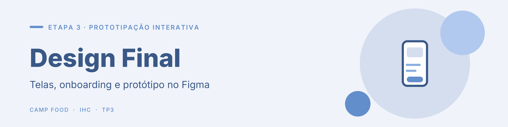

<p align="center"><b>Etapa 3 · Prototipação Interativa</b> &nbsp;›&nbsp; Design Final</p>

<p align="center"></p>

---

# 4. Design Final e Protótipo Interativo

> [!NOTE]
> **O que o enunciado pede:** design final desenvolvido **obrigatoriamente no Figma Design**, com **interações e transições configuradas** entre as telas (não basta apresentar telas estáticas), permitindo navegar pelos principais fluxos de uso. O protótipo deve ser **coerente com os artefatos anteriores** (HTAs, diagramas MoLIC e sketches). O **tutorial (onboarding)** deve ser apresentado **separadamente** no Figma, mostrando a sequência completa de telas e interações.

- [ ] Link do protótipo no Figma (modo *view*, acesso por link, sem login)
- [ ] Link do fluxo do **tutorial (onboarding)** em separado
- [ ] Telas finais exportadas nesta pasta
- [ ] Fluxos principais descritos e testados no modo apresentação
- [ ] Tabela de coerência com HTAs, MoLIC e sketches preenchida

---

## 4.1 Protótipo no Figma

| Item | Link |
|---|---|
| **Protótipo interativo (fluxos principais)** | **[PREENCHER]** |
| **Tutorial (onboarding)** — fluxo separado | **[PREENCHER]** |
| Arquivo de design (somente leitura, opcional) | **[PREENCHER]** |

**Como navegar:** **[PREENCHER]** (ex.: abrir o link, clicar em *Present* e iniciar pelo quadro “Início”; indicar o quadro de partida de cada fluxo).

## 4.2 Tutorial (onboarding)

O aplicativo apresenta, no **primeiro acesso**, um tutorial breve que introduz as principais funcionalidades e formas de interação.

| Passo | Tela | O que apresenta | Interação |
|---|---|---|---|
| 1 | **[PREENCHER]** | Boas-vindas ao Camp Food | **[PREENCHER]** (ex.: botão “Começar”) |
| 2 | **[PREENCHER]** | **[PREENCHER]** | **[PREENCHER]** |
| 3 | **[PREENCHER]** | **[PREENCHER]** | **[PREENCHER]** |
| 4 | **[PREENCHER]** | **[PREENCHER]** | **[PREENCHER]** (ex.: botão “Pular” disponível em todas as telas) |

<!-- <p align="center"></p> -->

<p align="center"><sub><b>Figura 1.</b> **[PREENCHER]** Sequência completa do tutorial.</sub></p>

## 4.3 Fluxos principais

Descreva cada fluxo demonstrado no protótipo, indicando perfil de usuário, tarefa e telas percorridas.

### Fluxo 1 — Acesso e criação de conta (todos os perfis)

- **Tarefa:** **[PREENCHER]**
- **Caminho no protótipo:** **[PREENCHER]** (ex.: Início → Entrar → Home)
- **Respostas do sistema:** **[PREENCHER]** (ex.: validação do formulário, mensagem de erro, carregamento)

### Fluxo 2 — Perfil Vendedor

- **Tarefa:** **[PREENCHER]** (ex.: cadastrar produto, atualizar disponibilidade, acompanhar pedidos)
- **Caminho no protótipo:** **[PREENCHER]**
- **Respostas do sistema:** **[PREENCHER]**

### Fluxo 3 — Perfil Comprador

- **Tarefa:** **[PREENCHER]** (ex.: localizar vendedores, consultar produto, realizar pedido)
- **Caminho no protótipo:** **[PREENCHER]**
- **Respostas do sistema:** **[PREENCHER]**

### Fluxo 4 — Acessibilidade

- **Tarefa:** **[PREENCHER]** (ex.: ajustar tamanho da fonte e contraste)
- **Caminho no protótipo:** **[PREENCHER]**
- **Respostas do sistema:** **[PREENCHER]**

> Acrescente ou remova fluxos conforme o protótipo final.

## 4.4 Telas finais

Catálogo das telas exportadas (arquivos nesta pasta). Use um nome de arquivo por tela, na ordem do fluxo.

| ID | Tela | Perfil | Arquivo | Nome do quadro no Figma |
|---|---|---|---|---|
| T01 | **[PREENCHER]** | Todos | `T01-**[PREENCHER]**.png` | **[PREENCHER]** |
| T02 | | | | |
| T03 | | | | |
| T04 | | | | |
| T05 | | | | |

### Galeria

**[PREENCHER]** Inserir as telas por fluxo (exemplo de grade em HTML; ajuste a quantidade de colunas):

<!--
<p align="center">
  
  
  
  
</p>
-->

<p align="center"><sub><b>Figura 2.</b> **[PREENCHER]** legenda da galeria.</sub></p>

## 4.5 Coerência com os artefatos anteriores

O protótipo deve refletir o que foi definido no [repositório do TP2]([PREENCHER: link]).

| Artefato do TP2 | Referência | Onde aparece no protótipo |
|---|---|---|
| HTA 01 — Acesso ao Camp Food | Todos os perfis | **[PREENCHER]** (telas T--) |
| HTA 02 — Divulgação dos Produtos | Vendedora | **[PREENCHER]** |
| HTA 03 — Atualização da Disponibilidade dos Produtos | Vendedora | **[PREENCHER]** |
| HTA 04 — Organização e Acompanhamento dos Pedidos | Vendedora | **[PREENCHER]** |
| HTA 05 — Localização de Vendedores e Seleção de Produtos | Comprador | **[PREENCHER]** |
| HTA 06 — Consulta de Informações e Decisão de Compra | Comprador | **[PREENCHER]** |
| HTA 07 — Consulta e Compra com Acessibilidade | Compradora com necessidades de acessibilidade | **[PREENCHER]** |
| MoLIC — Acesso e autenticação | Todos | **[PREENCHER]** |
| MoLIC — Fluxo da Vendedora | Vendedora | **[PREENCHER]** |
| MoLIC — Fluxo do Comprador | Comprador | **[PREENCHER]** |
| Sketches (Acesso, Produtos, Pedidos, Explorar, Detalhes) | Ambos | **[PREENCHER]** (o que mudou do sketch para o design final e por quê) |

### Decisões que mudaram em relação aos sketches

**[PREENCHER]** Liste as alternativas escolhidas (A ou B) e ajustes feitos, com justificativa.

## 4.6 Arquivos desta seção

Coloque os arquivos diretamente nesta pasta, com nomes descritivos (ex.: `T01-acesso.png`).

```text
4-design-final/
├── design-final.md
├── banner.png
└── (telas exportadas e sequência do onboarding)
```


---

<p align="center"><a href="../3-icones-ilustracoes/icones-ilustracoes.md">← Ícones e Ilustrações</a> &nbsp;·&nbsp; <a href="../5-microinteracoes/microinteracoes.md">Microinterações →</a></p>
