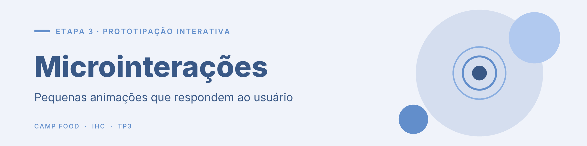

<p align="center"><b>Etapa 3 · Prototipação Interativa</b> &nbsp;›&nbsp; Microinterações</p>

<p align="center"></p>

---

# 5. Microinterações

> [!NOTE]
> **O que o enunciado pede (estrutura do repositório):** vídeos ou **GIFs de microanimações** do protótipo. As microinterações devem demonstrar as transições e respostas do sistema configuradas no Figma.

- [ ] GIFs ou vídeos salvos nesta pasta
- [ ] Cada microinteração descrita (gatilho, resposta, finalidade)
- [ ] Relação com heurísticas (principalmente visibilidade do estado e feedback)

> [!TIP]
> **Peso dos arquivos:** o GitHub renderiza GIFs na página, mas arquivos acima de 10 MB carregam lento (e acima de 100 MB são bloqueados). Para vídeos (`.mp4`), prefira arquivos curtos e use o link do arquivo na tabela; vídeos longos podem ser hospedados fora e linkados aqui.

---

## 5.1 Visão geral

| # | Microinteração | Tela | Gatilho | Resposta do sistema | Finalidade | Arquivo |
|---|---|---|---|---|---|---|
| 1 | **[PREENCHER]** (ex.: botão pressionado) | **[PREENCHER]** | **[PREENCHER]** (ex.: toque) | **[PREENCHER]** (ex.: mudança de cor + ondulação) | **[PREENCHER]** (ex.: confirmar que o toque foi registrado) | `**[PREENCHER]**.gif` |
| 2 | **[PREENCHER]** (ex.: carregamento) | | | | | |
| 3 | **[PREENCHER]** (ex.: confirmação de pedido) | | | | | |
| 4 | **[PREENCHER]** (ex.: erro em formulário) | | | | | |
| 5 | **[PREENCHER]** (ex.: troca de tela) | | | | | |

## 5.2 Detalhamento

Repita o bloco abaixo para cada microinteração.

### Microinteração 1 — **[PREENCHER]** nome

<!-- <p align="center"></p> -->

<p align="center"><sub><b>Figura 1.</b> **[PREENCHER]** legenda.</sub></p>

- **Onde acontece:** **[PREENCHER]**
- **Gatilho:** **[PREENCHER]**
- **Resposta visual (e sonora/tátil, se houver):** **[PREENCHER]**
- **Duração e suavização (*easing*):** **[PREENCHER]** (ex.: 300 ms, *ease-out*)
- **Por que existe:** **[PREENCHER]**
- **Heurística relacionada:** **[PREENCHER]** (ex.: Heurística 1 — Visibilidade do estado do sistema)

### Microinteração 2 — **[PREENCHER]** nome

<!-- <p align="center"></p> -->

- **Onde acontece:** **[PREENCHER]**
- **Gatilho:** **[PREENCHER]**
- **Resposta:** **[PREENCHER]**
- **Por que existe:** **[PREENCHER]**

## 5.3 Transições entre telas

| Transição | Tipo no Figma | Duração | Justificativa |
|---|---|---|---|
| **[PREENCHER]** (ex.: Home → Detalhes do produto) | Ex.: *Smart animate* / *Move in* | -- ms | **[PREENCHER]** |
| | | | |

## 5.4 Vídeo de demonstração do fluxo completo (opcional)

**[PREENCHER]** Link ou arquivo: `**[PREENCHER]**.mp4`

## 5.5 Arquivos desta seção

Coloque os arquivos diretamente nesta pasta, com nomes descritivos (ex.: `T01-acesso.png`).

```text
5-microinteracoes/
├── microinteracoes.md
├── banner.png
└── (GIFs e vídeos de microanimações)
```


---

<p align="center"><a href="../4-design-final/design-final.md">← Design Final</a> &nbsp;·&nbsp; <a href="../6-heuristicas-ux/heuristicas-ux.md">Heurísticas e UX →</a></p>
