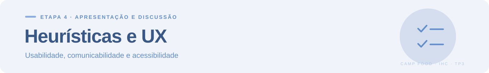

<p align="center"><a href="../../README.md">Início</a> &nbsp;›&nbsp; <b>Etapa 4 · Apresentação e Discussão</b> &nbsp;›&nbsp; Heurísticas e UX</p>

<p align="center"></p>

---

# 6. Heurísticas, UX, Comunicabilidade e Acessibilidade

> [!NOTE]
> **O que o enunciado pede:**
> - Demonstrar **usabilidade, comunicabilidade e coerência visual** em todas as telas;
> - Indicar as **heurísticas de Nielsen** aplicadas e explicar brevemente **onde e como** se manifestam. Exemplo do enunciado: *“Heurística 1 – Visibilidade do estado do sistema: uso de loading spinner e feedback visual ao enviar formulário.”*
> - Incluir **considerações de acessibilidade** (contraste, tamanho de toque, texto alternativo);
> - Apresentar **evidências de signos metalinguísticos** (ícones que explicam ou reforçam mensagens, feedbacks, cores que comunicam estado do sistema).

- [ ] Heurísticas de Nielsen aplicadas, com tela e explicação
- [ ] Usabilidade e UX avaliadas
- [ ] Comunicabilidade com signos estáticos, dinâmicos e metalinguísticos
- [ ] Acessibilidade (contraste, alvo de toque, texto alternativo, fonte ajustável)
- [ ] Coerência visual demonstrada

---

## 6.1 Heurísticas de Nielsen

Para cada heurística aplicada: **onde** aparece (tela) e **como** se manifesta. Heurísticas não aplicadas ao protótipo podem ser marcadas como “não aplicável” com justificativa.

| # | Heurística | Onde (tela) | Como se manifesta | Evidência |
|---|---|---|---|---|
| 1 | Visibilidade do estado do sistema | **[PREENCHER]** | **[PREENCHER]** | `imagens/heuristica-1.png` |
| 2 | Correspondência entre o sistema e o mundo real | **[PREENCHER]** | **[PREENCHER]** | `imagens/heuristica-2.png` |
| 3 | Controle e liberdade do usuário | **[PREENCHER]** | **[PREENCHER]** | `imagens/heuristica-3.png` |
| 4 | Consistência e padrões | **[PREENCHER]** | **[PREENCHER]** | `imagens/heuristica-4.png` |
| 5 | Prevenção de erros | **[PREENCHER]** | **[PREENCHER]** | `imagens/heuristica-5.png` |
| 6 | Reconhecimento em vez de memorização | **[PREENCHER]** | **[PREENCHER]** | `imagens/heuristica-6.png` |
| 7 | Flexibilidade e eficiência de uso | **[PREENCHER]** | **[PREENCHER]** | `imagens/heuristica-7.png` |
| 8 | Design estético e minimalista | **[PREENCHER]** | **[PREENCHER]** | `imagens/heuristica-8.png` |
| 9 | Ajudar usuários a reconhecer, diagnosticar e corrigir erros | **[PREENCHER]** | **[PREENCHER]** | `imagens/heuristica-9.png` |
| 10 | Ajuda e documentação | **[PREENCHER]** | **[PREENCHER]** | `imagens/heuristica-10.png` |

> **Formato sugerido para a explicação:** *Heurística N — Nome: o que foi feito + feedback ao usuário.* Ex.: *Heurística 1 — Visibilidade do estado do sistema: indicador de carregamento e mensagem de confirmação ao enviar o pedido.*

### Detalhamento (por heurística)

Repita o bloco para as heurísticas mais relevantes.

#### Heurística **[PREENCHER]** — **[PREENCHER]** nome

<!-- <p align="center"></p> -->

- **Tela:** **[PREENCHER]**
- **O que foi aplicado:** **[PREENCHER]**
- **Benefício para o usuário:** **[PREENCHER]**
- **Persona beneficiada:** **[PREENCHER]** (Mariana, Gabriel ou Camila)

---

## 6.2 Usabilidade

**[PREENCHER]** Avalie o protótipo segundo os atributos de usabilidade e relacione com as telas.

| Atributo | Como o design atende | Telas |
|---|---|---|
| Facilidade de aprendizado | **[PREENCHER]** | **[PREENCHER]** |
| Eficiência | **[PREENCHER]** | **[PREENCHER]** |
| Facilidade de memorização | **[PREENCHER]** | **[PREENCHER]** |
| Prevenção e recuperação de erros | **[PREENCHER]** | **[PREENCHER]** |
| Satisfação subjetiva | **[PREENCHER]** | **[PREENCHER]** |

## 6.3 Experiência do usuário (UX)

**[PREENCHER]** Descreva como a experiência pretendida no [mural de inspiração](../1-mural-de-inspiracao/README.md) e na metamensagem do TP2 foi traduzida em decisões de interface (jornada, emoções, momentos de destaque).

## 6.4 Comunicabilidade (Engenharia Semiótica)

Evidencie como o designer “conversa” com o usuário pela interface.

| Tipo de signo | Exemplo no Camp Food | Tela | Mensagem comunicada |
|---|---|---|---|
| **Estático** (aparência, layout, cores) | **[PREENCHER]** | **[PREENCHER]** | **[PREENCHER]** |
| **Dinâmico** (comportamento no tempo, transições) | **[PREENCHER]** | **[PREENCHER]** | **[PREENCHER]** |
| **Metalinguístico** (explica ou reforça a comunicação: ícones que reforçam mensagens, feedbacks, cores de estado) | **[PREENCHER]** | **[PREENCHER]** | **[PREENCHER]** |

### Evidências de signos metalinguísticos

| Situação | Signo (ícone / cor / texto) | Como reforça a mensagem | Tela |
|---|---|---|---|
| Sucesso | **[PREENCHER]** | **[PREENCHER]** | **[PREENCHER]** |
| Erro | **[PREENCHER]** | **[PREENCHER]** | **[PREENCHER]** |
| Alerta / atenção | **[PREENCHER]** | **[PREENCHER]** | **[PREENCHER]** |
| Carregando | **[PREENCHER]** | **[PREENCHER]** | **[PREENCHER]** |
| Item indisponível | **[PREENCHER]** | **[PREENCHER]** | **[PREENCHER]** |

<!-- <p align="center"></p> -->

## 6.5 Acessibilidade

| Critério | Referência | Como foi atendido | Evidência / tela |
|---|---|---|---|
| Contraste de texto | WCAG: ≥ 4,5:1 (texto normal), ≥ 3:1 (texto grande) | **[PREENCHER]** — ver [tabela de contraste](../2-paleta-tipografia/README.md) | **[PREENCHER]** |
| Contraste de ícones e componentes | WCAG: ≥ 3:1 | **[PREENCHER]** | **[PREENCHER]** |
| Tamanho da área de toque | Material: mínimo de 48 × 48 dp | **[PREENCHER]** | **[PREENCHER]** |
| Texto alternativo / rótulos para leitor de tela | Descrição para imagens e ícones interativos | **[PREENCHER]** (ex.: textos alternativos anotados no Figma) | **[PREENCHER]** |
| Ajuste do tamanho de fonte | Fonte escalável | **[PREENCHER]** | **[PREENCHER]** |
| Cor não é o único meio de informação | Cor + ícone + texto | **[PREENCHER]** | **[PREENCHER]** |
| Foco e ordem de leitura | Ordem lógica de navegação | **[PREENCHER]** | **[PREENCHER]** |

**[PREENCHER]** Relacione as decisões de acessibilidade à persona **Camila Rodrigues** e à HTA 07 do TP2.

## 6.6 Coerência visual

**[PREENCHER]** Demonstre a consistência entre as telas (cores, tipografia, ícones, espaçamentos, componentes).

| Elemento | Padrão adotado | Exemplos de telas que o seguem |
|---|---|---|
| Botão primário | **[PREENCHER]** | **[PREENCHER]** |
| Cabeçalho / barra superior | **[PREENCHER]** | **[PREENCHER]** |
| Cartões de produto | **[PREENCHER]** | **[PREENCHER]** |
| Formulários e campos | **[PREENCHER]** | **[PREENCHER]** |
| Mensagens de feedback | **[PREENCHER]** | **[PREENCHER]** |

## 6.7 Arquivos desta seção

```text
6-heuristicas-ux/
├── README.md
└── imagens/        # telas anotadas por heurística, contrastes, signos e acessibilidade
```


---

<p align="center"><a href="../5-microinteracoes/README.md">← Microinterações</a> &nbsp;·&nbsp; <a href="../../README.md">Início →</a></p>
